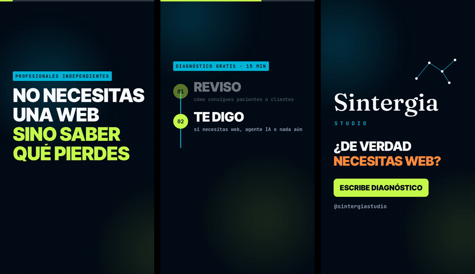

<div align="center">

# reel-ai

**Videos verticales animados para Reels, TikTok y Shorts, a partir de un archivo JSON.**
Tu agente de IA escribe el guion; el render es código determinista.

[Español](#español) · [English](#english) · [Documentación](docs/) · [MIT](LICENSE)




</div>

---

## Español

### Qué es

Una herramienta de línea de comandos que convierte un archivo JSON en un video vertical
animado de 1080×1920, listo para publicar. Sin editor de video, sin plantillas de Canva, sin
suscripción.

Lo que la hace distinta de otras herramientas de "video con IA": **el modelo no genera el
video**. Genera un archivo de texto que describe el video, y el render lo hace código normal.

```
   tu idea  ──►  un LLM  ──►  escena.json  ──►  Chromium + FFmpeg  ──►  video.mp4
                    │              │
       la parte creativa      el contrato        la parte determinista
      (qué decir y cuándo)                     (siempre el mismo resultado)
```

Esto tiene tres consecuencias prácticas:

- **Funciona con cualquier agente y cualquier modelo.** No hay integración que hacer: le das
  la especificación a Claude, a ChatGPT, a Gemini o a un modelo local, y te devuelve el JSON.
  El proyecto no sabe —ni le importa— quién lo escribió.
- **El mismo JSON da siempre el mismo video.** Podés versionar tus escenas en git.
- **Podés escribirlas vos.** Son 30 líneas de JSON. Sin IA, sin clave de API, sin costo.

### Probarlo sin instalar nada

Si querés ver qué hace antes de bajarlo:

1. Hacé un **fork** de este repositorio.
2. Andá a la pestaña **Actions** y tocá *I understand my workflows, go ahead and enable them*
   (GitHub desactiva los workflows en los forks). Después: *Renderizar escena* → **Run workflow**.
3. Dejá la escena por defecto (o poné otra de `examples/`) y dale.
4. A los 3-4 minutos, descargá el `.mp4` desde los artefactos del run.

Todo corre en los runners de GitHub: **no instalás nada y no hace falta ninguna clave de
API**. El mismo workflow se dispara solo cuando subís un JSON a `motion/scenes/`, así que
podés editar una escena desde el navegador y recibir el video hecho.

En repositorios públicos los minutos de Actions son gratis.

### Con Docker (Windows, macOS y Linux)

La forma más simple de tenerlo en tu máquina: **un solo requisito**, [Docker Desktop](https://www.docker.com/products/docker-desktop/).
Nada de Python, Node, FFmpeg ni Chromium: todo viene dentro de la imagen (Intel y Apple Silicon).

Abrí una terminal en la carpeta donde vas a guardar tus escenas y corré:

```bash
# macOS / Linux
docker run --rm -v "$PWD:/work" ghcr.io/jesusfelipeb/reel-ai render mi-video.json

# Windows (PowerShell)
docker run --rm -v "${PWD}:/work" ghcr.io/jesusfelipeb/reel-ai render mi-video.json
```

El video aparece en `output/motion/` dentro de esa misma carpeta. Los comandos son los mismos
que en la instalación local (`init`, `doctor`, `validate`, `stills`, `render`), y todos aceptan
`--json` para que los lea un agente. Para probar sin escribir nada, usá un ejemplo de la imagen:

```bash
docker run --rm -v "$PWD:/work" ghcr.io/jesusfelipeb/reel-ai stills /app/examples/primer-video.json
```

Si tenés `themes/` o `.env` en tu carpeta, se usan. En Linux agregá `--user "$(id -u):$(id -g)"`
para que los archivos generados queden a tu nombre y no de root. Docker casi no agrega
tiempo: 30 s de video tardaron 1:49 en Docker y 1:41 nativo, en la misma laptop.

### Instalación

Para trabajar en serio conviene tenerlo local: iterar con `--stills` tarda segundos en vez
de minutos. Necesitás **Python 3.10+**, **Node 20+** y **FFmpeg** en el sistema.

```bash
git clone https://github.com/jesusfelipeb/reel-ai.git
cd reel-ai

python -m venv venv && source venv/bin/activate
pip install -r requirements.txt
npm install                      # Playwright + Chromium

python scripts/doctor.py         # ¿falta algo? te dice qué y cómo resolverlo
```

`doctor.py` revisa las versiones, FFmpeg, Chromium y las tipografías, y para cada cosa que
falta te da el comando exacto.

### Tu primer video

```bash
python -m motion.compose_text examples/diagnostico-gratis-reel-test.json
```

Menos de dos minutos después tenés `output/motion/diagnostico-gratis-reel-test.mp4`: 29,6 s,
1080×1920, listo para subir. (Son ~900 capturas de Chromium: 1:41 en una laptop con Ryzen 7
5700U.)

Para iterar sin esperar el render completo, pedí capturas sueltas:

```bash
python -m motion.compose_text examples/diagnostico-gratis-reel-test.json --stills 3,12,22
```

Tarda segundos y te deja tres PNG para revisar el diseño.

### Hacer el tuyo

Copiá el ejemplo neutro (es de dominio público) y editá el texto:

```bash
cp examples/primer-video.json motion/scenes/mi-video.json
```

> Acordate de cambiar el campo `name` adentro del JSON: **el nombre del archivo de salida sale
> de ahí**, no del nombre del archivo. Si no lo cambiás, vas a pisar el video del ejemplo.

Una escena es una lista de bloques con sus tiempos:

```json
{
  "name": "mi-video",
  "duration": 28.0,
  "beats": [
    { "type": "hook", "in": 0.0, "out": 6.0,
      "chip": "PROFESIONALES INDEPENDIENTES",
      "lines": ["NO NECESITAS", "UNA WEB", "SINO SABER", "QUÉ PIERDES"],
      "accent": [2, 3] },
    { "type": "steps", "in": 6.0, "out": 22.0,
      "chip": "DIAGNÓSTICO GRATIS · 15 MIN",
      "steps": [
        {"title": "REVISO",  "sub": "cómo consigues clientes hoy"},
        {"title": "TE DIGO", "sub": "si necesitas una web o no"},
        {"title": "SALES",   "sub": "con un plan, sin compromiso"}
      ] },
    { "type": "end", "in": 22.0, "out": 28.0,
      "wordmark": "Tu Marca", "studio": "STUDIO",
      "headline": ["¿DE VERDAD", "NECESITAS WEB?"],
      "cta": "ESCRIBE DIAGNÓSTICO", "handle": "@tumarca" }
  ]
}
```

Los beats van pegados —el `out` de uno es el `in` del siguiente— y `duration` coincide con el
`out` del último. Si dejás un hueco, el validador te lo dice.

Hay **8 tipos de bloque** (gancho, pasos, lista, etiquetas, comparación, cierre…). Los tiempos
internos de cada animación se calculan solos a partir de `in` y `out`: vos solo decís qué dice
y cuándo. La especificación completa está en **[docs/BEATS.md](docs/BEATS.md)**.

Antes de renderizar, validá:

```bash
python scripts/validate_scene.py motion/scenes/mi-video.json
```

Comprueba tiempos, campos y —lo que más se rompe— que ningún texto se salga de la pantalla.

### Que lo haga tu agente (la forma recomendada)

reel-ai está pensado para usarse **hablándole a tu agente**: Claude Code, Codex, Cursor o
cualquiera que pueda leer archivos y correr comandos. Vos pedís el video; el agente escribe
la escena, la valida, **mira las capturas** para revisar el diseño y renderiza.

Lo único que necesitás instalado es el agente y [Docker Desktop](https://www.docker.com/products/docker-desktop/).
Creá una carpeta vacía, abrí tu agente ahí y pegale esto:

> Quiero hacer reels con reel-ai (https://github.com/jesusfelipeb/reel-ai). Prepará esta
> carpeta corriendo `docker run --rm -v "$PWD:/work" ghcr.io/jesusfelipeb/reel-ai init`
> (en Windows, `${PWD}` en vez de `$PWD`), leé el `AGENTS.md` que aparece y seguilo.

`init` deja en la carpeta un **[AGENTS.md](AGENTS.md)** con todo el flujo: la primera vez el
agente te hace seis preguntas sobre tu marca y escribe tu `brief.md`; después, cada video es
pedirlo en una frase. Codex lee `AGENTS.md` directamente y Claude Code lo lee a través de
`CLAUDE.md`, que solo lo importa: **las mismas instrucciones para los dos**.

Si clonaste el repo, no hace falta `init`: el `AGENTS.md` ya está y el agente usa
`python reel.py` en vez de Docker.

¿Usás un chat sin acceso a archivos (ChatGPT, Gemini web)? **[docs/PROMPT.md](docs/PROMPT.md)**
trae un prompt para pegar; el JSON que te devuelve lo validás y renderizás vos.

### Que no te escriba genérico

Hacé eso y vas a recibir una escena **válida y sosa**: pasa el validador, renderiza, y no la
mira nadie. Le pediste el formato, no le diste contexto.

Lo que lo cambia es un **brief de marca**: quién sos, a quién le hablás, cómo escribís y qué
ganchos tuyos ya funcionaron. Lo escribís una vez en `brief.md` y lo antepones siempre — o se
lo nombrás a tu agente, que es lo mismo con menos pasos:

> Leé `brief.md` y `docs/BEATS.md`, escribí una escena sobre [tema]…

Plantilla y ejemplo lleno: **[docs/BRIEF.md](docs/BRIEF.md)**. Diez minutos, y es lo que más
mueve la calidad de lo que recibís.

Lo que el brief **no** arregla es cuánto decir: un modelo tiende a meter siete ideas en medio
minuto. Por eso el validador también avisa cuando el video es muy corto o va muy apurado.

### Poner tu marca

Todos los colores y tipografías están en un solo archivo:

```bash
cp themes/neutral.json themes/mi-marca.json   # editá los colores
echo "REEL_BRAND=mi-marca" >> .env
```

Detalles y la única regla que no se puede romper: **[docs/MARCA.md](docs/MARCA.md)**.

### Los tres pipelines

| | entrada | ¿IA? | estado |
|---|---|:--:|---|
| **Texto animado** `motion/compose_text.py` | una escena JSON | no | 🟢 **Estable.** Empezá por acá. |
| **Híbrido** `motion/compose.py` | video + transcripción + escena | no | 🟡 Funciona; probado con **una** escena. |
| **Video largo → 5 shorts** `main.py` | un video horizontal | sí | 🟡 Funciona; probado con **un** video. |

El tercero transcribe con Whisper, le pide a un LLM los 5 mejores fragmentos de 30-60 s y
arma cinco verticales con subtítulos quemados y gráficos. Es el único que necesita una clave
de API, y sirve cualquier proveedor compatible con OpenAI —Groq, OpenAI, OpenRouter,
Ollama— cambiando tres variables ([docs/PROVEEDORES.md](docs/PROVEEDORES.md)).

**Los estados de arriba son honestos.** Lo que no se probó está en
**[docs/LIMITACIONES.md](docs/LIMITACIONES.md)**: lo que no anda, lo que nunca se corrió y los
límites duros. Léelo antes de contar con esto para algo importante.

### Documentación

| | |
|---|---|
| [ARQUITECTURA.md](docs/ARQUITECTURA.md) | Cómo funciona y por qué. Las decisiones no obvias. |
| [BEATS.md](docs/BEATS.md) | La especificación del JSON. Los 8 tipos de bloque. |
| [PROMPT.md](docs/PROMPT.md) | El prompt para que tu agente escriba escenas. |
| [BRIEF.md](docs/BRIEF.md) | Tu voz y tu público, escritos una vez. |
| [MARCA.md](docs/MARCA.md) | Poner tus colores y tipografías. |
| [PROVEEDORES.md](docs/PROVEEDORES.md) | Groq, OpenAI, OpenRouter, Ollama. |
| [LIMITACIONES.md](docs/LIMITACIONES.md) | Qué no se probó y qué no anda. |
| [examples/](examples/) | Escenas reales, publicadas. |

### Licencia

Código bajo [MIT](LICENSE). Las tipografías son SIL OFL y las escenas de ejemplo son material
comercial de su autor: ver [NOTICE](NOTICE).

---

## English

### What it is

A command-line tool that turns a JSON file into an animated 1080×1920 vertical video, ready
to post. No video editor, no templates, no subscription.

What makes it different from other "AI video" tools: **the model doesn't generate the video**.
It generates a text file describing the video, and ordinary code renders it.

```
   your idea  ──►  an LLM  ──►  scene.json  ──►  Chromium + FFmpeg  ──►  video.mp4
                      │              │
             the creative part   the contract        the deterministic part
```

Which means it **works with any agent and any model** — there's nothing to integrate. You
hand the spec to Claude, ChatGPT, Gemini or a local model and it returns JSON. The project
neither knows nor cares who wrote it. The same JSON always produces the same video. And you
can write scenes by hand: it's 30 lines of JSON, no API key, no cost.

### Try it without installing anything

Fork this repo, open the **Actions** tab and enable workflows (GitHub disables them on forks),
then *Renderizar escena* → **Run workflow**, keep the
default scene and run it. Three or four minutes later the `.mp4` is waiting in the run's
artifacts. It all happens on GitHub's runners — nothing installed locally, no API key
needed. The same workflow fires automatically when you push a JSON to `motion/scenes/`, so
you can edit a scene in the browser and get the video back.

Actions minutes are free on public repositories.

### With Docker (Windows, macOS, Linux)

One requirement: [Docker Desktop](https://www.docker.com/products/docker-desktop/). Python,
Node, FFmpeg and Chromium all live inside the image (Intel and Apple Silicon). From the folder
holding your scenes:

```bash
docker run --rm -v "$PWD:/work" ghcr.io/jesusfelipeb/reel-ai render my-video.json     # macOS / Linux
docker run --rm -v "${PWD}:/work" ghcr.io/jesusfelipeb/reel-ai render my-video.json   # Windows PowerShell
```

The video lands in `output/motion/` in that same folder. Commands: `init`, `doctor`, `validate`,
`stills`, `render`, all with `--json` for agents. On Linux add `--user "$(id -u):$(id -g)"`.

### Install

Worth it for real work — iterating with `--stills` takes seconds instead of minutes.
Requires **Python 3.10+**, **Node 20+** and **FFmpeg**.

```bash
git clone https://github.com/jesusfelipeb/reel-ai.git
cd reel-ai

python -m venv venv && source venv/bin/activate
pip install -r requirements.txt
npm install

python scripts/doctor.py     # tells you exactly what's missing and how to fix it
```

### Your first video

```bash
python -m motion.compose_text examples/diagnostico-gratis-reel-test.json

# or just a few frames, to iterate on the design in seconds
python -m motion.compose_text examples/diagnostico-gratis-reel-test.json --stills 3,12,22
```

### Writing a scene

A scene is a list of timed blocks. There are **8 block types** (hook, steps, list, tags,
comparison, closing card…). Internal animation timing is derived from `in`/`out`, so you only
say *what* and *when* — never *how*. That's what lets a small model write valid scenes.

```json
{
  "name": "my-video",
  "duration": 24.0,
  "beats": [
    { "type": "hook", "in": 0.0, "out": 6.0,
      "chip": "INDEPENDENT PROFESSIONALS",
      "lines": ["YOU DON'T", "NEED A SITE", "YOU NEED", "THE NUMBERS"],
      "accent": [2, 3] },
    { "type": "steps", "in": 6.0, "out": 18.0,
      "chip": "FREE 15-MINUTE REVIEW",
      "steps": [
        {"title": "I LOOK", "sub": "at how clients find you today"},
        {"title": "I TELL", "sub": "whether a site would help at all"},
        {"title": "YOU GO", "sub": "with a plan, no strings attached"}
      ] },
    { "type": "end", "in": 18.0, "out": 24.0,
      "wordmark": "Your Brand", "studio": "STUDIO",
      "headline": ["DO YOU REALLY", "NEED A SITE?"],
      "cta": "MESSAGE REVIEW", "handle": "@yourbrand" }
  ]
}
```

Beats are contiguous — one's `out` is the next one's `in` — and `duration` equals the last
`out`. Headline lines are short on purpose: text does not wrap, so a long line runs off the
canvas. The validator catches both.

Validate before rendering — it catches timing errors and, above all, text that would overflow
the screen:

```bash
python scripts/validate_scene.py motion/scenes/my-video.json
```

### Let your agent do it (recommended)

reel-ai is meant to be driven by an agent — Claude Code, Codex, Cursor. You ask for the video;
the agent writes the scene, validates it, **looks at the captures** to check the design, and
renders. You only need the agent and Docker Desktop. Open the agent in an empty folder and say:

> I want to make reels with reel-ai (https://github.com/jesusfelipeb/reel-ai). Set up this
> folder by running `docker run --rm -v "$PWD:/work" ghcr.io/jesusfelipeb/reel-ai init`,
> then read the `AGENTS.md` it creates and follow it.

The first time, the agent asks six questions about your brand and writes `brief.md` — that
is what keeps the scenes from being valid but bland. Codex reads [`AGENTS.md`](AGENTS.md)
natively; Claude Code reads it through a one-line `CLAUDE.md`. Same instructions for both.
The instructions are in Spanish; the agent will talk to you in your language.

For chat-only models (ChatGPT, Gemini web), [`docs/PROMPT.md`](docs/PROMPT.md) has a
paste-anywhere prompt.

### Your own colors

```bash
cp themes/neutral.json themes/my-brand.json   # edit the colors
echo "REEL_BRAND=my-brand" >> .env
```

The palette and fonts live in that one file, read by both the Python side and the HTML
templates. See [`docs/MARCA.md`](docs/MARCA.md).

### Three pipelines

| | input | AI? | status |
|---|---|:--:|---|
| **Animated text** `motion/compose_text.py` | a JSON scene | no | 🟢 **Stable.** Start here. |
| **Hybrid** `motion/compose.py` | video + transcript + scene | no | 🟡 Works; tested on **one** scene. |
| **Long video → 5 shorts** `main.py` | a horizontal video | yes | 🟡 Works; tested on **one** video. |

The third transcribes with Whisper, asks an LLM for the five best 30-60 s moments and builds
five verticals with burned-in captions. It's the only one needing an API key, and any
OpenAI-compatible provider works — Groq, OpenAI, OpenRouter, Ollama.

**Those statuses are honest.** What wasn't tested, what's broken and the hard limits are all
in [docs/LIMITACIONES.md](docs/LIMITACIONES.md).

### Documentation

> **The deep documentation is in Spanish.** This README is the bilingual entry point; the
> guides below are not translated yet. The code, the JSON field names and the error messages
> are a mix of English and Spanish. Translation contributions are welcome.

| | |
|---|---|
| [ARQUITECTURA.md](docs/ARQUITECTURA.md) | How it works and why. The non-obvious decisions. |
| [BEATS.md](docs/BEATS.md) | The JSON spec. All 8 block types, with measured text limits. |
| [PROMPT.md](docs/PROMPT.md) | A paste-anywhere prompt so your agent writes scenes. |
| [BRIEF.md](docs/BRIEF.md) | Your voice and audience, written once and reused. |
| [MARCA.md](docs/MARCA.md) | Your colors and fonts. |
| [PROVEEDORES.md](docs/PROVEEDORES.md) | Groq, OpenAI, OpenRouter, Ollama. |
| [LIMITACIONES.md](docs/LIMITACIONES.md) | What wasn't tested and what's broken. |

### License

[MIT](LICENSE) for the code. Fonts are SIL OFL and the example scenes are their author's
commercial material — see [NOTICE](NOTICE).
